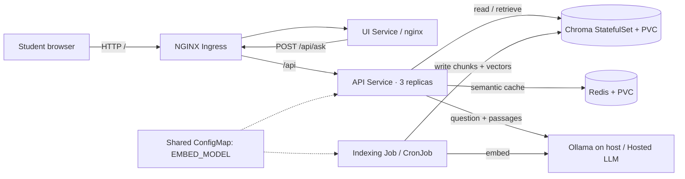

# RAHBAR (Grounded RAG on Kubernetes) 

[](https://github.com/Saliha-Noor/Rahbar/actions/workflows/ci.yml)

RAHBAR is a document-grounded question-answering service for FAST-NUCES public academic and administrative material. A question is embedded with the same pinned model used during indexing, relevant passages are retrieved from ChromaDB, and the answer is generated against those passages with structured citations. When the corpus does not contain enough evidence, the API abstains rather than inventing a policy. The system separates its one-shot indexing workload from its read-only API, and deploys the UI, API, ChromaDB, Redis, and supporting Kubernetes resources in the `rahbar` namespace.

## Architecture



**Design rule:** the indexer is the only Chroma writer; API replicas only read. Chroma is a StatefulSet with a `volumeClaimTemplates` PVC so its stable identity and persistent data volume remain coupled. Redis has a PVC for cache persistence. The NetworkPolicy defaults to deny and selectively permits required traffic.

---

## RAGOps Layer — How to Run Parts A to F

All operations run against the `rahbar` namespace (`export NS=rahbar`). Use the helper script `scripts/ragops.sh` for cluster operations.

### Part A — Data Management (Verify & Incremental Update)

```bash
# A1: Run verification + update pipeline as a Kubernetes Job
scripts/ragops.sh ingest

# A1: Dry-run check (verification report only, nothing moved or indexed)
scripts/ragops.sh admin --dry-run

# A2: Rerun on unchanged corpus to prove 0 chunks embedded (idempotency)
scripts/ragops.sh ingest
# Log output confirms: chunks_embedded=0, docs_unchanged=N

# Batch B: Ingest Batch B with 10+ planted problem files (duplicates, corrupt PDF, injection, etc.)
scripts/ragops.sh load-batch-b && scripts/ragops.sh ingest
# Log output confirms: quarantined=6, docs_archived=1

# Document audit & orphan check (proves no orphan chunks)
scripts/ragops.sh admin --audit

# Version archiving and restore (rollback demo)
scripts/ragops.sh admin --archive <file>
scripts/ragops.sh admin --restore <file>
```

### Part B — Offline Testing at Three Levels

```bash
# Validate golden question set schema and distribution (37 questions)
python3 eval/check_golden.py

# Run full evaluation suite (Module, Component, End-to-End, Noise, Stochasticity)
scripts/ragops.sh eval baseline api A
# Results land in /data/results/ on the ragops-data PVC and eval/results/ locally
```

### Part C — Change Experiment & Release Gate

```bash
# C1: Build candidate collection (chunk_size=250, overlap=25)
scripts/ragops.sh ingest-collection rahbar-cand 250 25

# C2: Run candidate eval against api-candidate (GATE FAILS: recall drop regression)
scripts/ragops.sh eval candidate-c250 api-candidate A

# C2: Run release gate script directly with thresholds config
python3 eval/gate.py --candidate eval/results/candidate-c250-latest.json --baseline eval/results/baseline-latest.json

# C2: Show gate PASSING on improved candidate (after-batch-b)
python3 eval/gate.py --candidate eval/results/candidate-pass.json --baseline eval/results/baseline-latest.json --config eval/gate-passing.yaml

# C3 / F3: Canary release to candidate collection with rolling update
scripts/ragops.sh release rahbar-cand
scripts/ragops.sh trace-after "What is the CGPA for academic warning?"

# Rollback (undo) candidate release
scripts/ragops.sh undo
scripts/ragops.sh trace-after "What is the CGPA for academic warning?"
```

### Part D — Observability & Traceability

```bash
# D1: Extract full JSON trace record from API logs
kubectl logs deploy/api -n rahbar | grep '"event": "trace"' | tail -1

# D2: Rebuild exact prompt and retrieved context for a trace ID
kubectl exec deploy/api -n rahbar -- python3 -m app.tools.trace_show <trace_id>

# D3: Trace metrics summary over rolling window (queries, abstention, latency stages, injections)
kubectl exec deploy/api -n rahbar -- python3 -m app.tools.trace_summary --since 24h

# D4: Test prompt injection defense (retrieval guardrail redacts malicious instructions)
scripts/ragops.sh trace-after "At what time must students be seated before an exam?"
# Trace output shows guardrails: [{'action': 'redacted_injection', ...}]
```

### Part E — Coverage & Drift Checking

```bash
# E1 & E2: Measure live query coverage against baseline golden set (Stage A: 52.5%)
python3 eval/coverage.py --stage A --label before --threshold 0.70

# E4: Measure coverage after adding golden questions from uncovered topics (Stage E4: 67.5%)
python3 eval/coverage.py --stage E4 --label after --threshold 0.70

# E3: Drift evaluation after Batch B ingestion
scripts/ragops.sh eval after-batch-b api B
```

### Part F — Kubernetes Deployment & Resource Measurement

```bash
# Cluster overview
kubectl get all,pvc,configmap,cronjob,job -n rahbar

# Edit gate thresholds dynamically via ConfigMap (no rebuild needed)
kubectl edit configmap rahbar-gate -n rahbar

# Measure pod and node resource consumption (F5)
kubectl top pods -n rahbar
kubectl top nodes

# Pull all results and traces from cluster PVC to local repository
scripts/ragops.sh pull
```

---

## Prerequisites

- Docker, `kubectl`, `minikube`, `kubectl`'s Kustomize support, `make`, Python 3.12, and Ollama.
- At least 6 GB RAM and 4 CPUs for the minikube profile used here.
- On Linux, the minikube IP is used for the Ingress. With Docker driver on macOS/Windows, run `minikube tunnel` and use `127.0.0.1`.

## Local Cluster Setup

1. Start minikube with Calico (required for NetworkPolicy enforcement), metrics-server, and ingress:
   ```bash
   make cluster
   ```

2. Start Ollama on the host in a separate terminal:
   ```bash
   OLLAMA_HOST=0.0.0.0 ollama serve
   ollama pull llama3.2:1b
   ollama pull nomic-embed-text
   ```

3. Build and load the local images into minikube:
   ```bash
   make images
   ```

4. Apply the dev overlay:
   ```bash
   make apply
   kubectl get pods,pvc -n rahbar
   ```

## Repository Map

- `api/` — FastAPI read-only query service, health checks, metrics, retrieval, cache, and providers.
- `indexer/` — extraction, verification pipeline (`verify.py`), incremental updates (`update.py`), and Chroma writes.
- `eval/` — 37-question golden set (`golden.jsonl`), 3-level evaluation suite (`suite.py`), release gate (`gate.py`), and coverage checker (`coverage.py`).
- `eval/results/` — timestamped benchmark result files and gate decisions.
- `traces/` — collected query traces for observability and debugging.
- `k8s/` — Kubernetes base manifests, candidate deployment, eval Jobs, and overlays.
- `docs/` — [RAGOPS-REPORT.md](docs/RAGOPS-REPORT.md), [RAGOPS.md](docs/RAGOPS.md), architecture, ADRs, and evidence.
