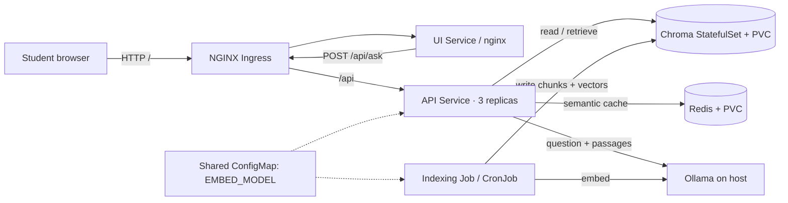

# RAHBAR — Grounded RAG on Kubernetes

[](https://github.com/Saliha-Noor/Rahbar/actions/workflows/ci.yml)

RAHBAR is a document-grounded question-answering service for FAST-NUCES public academic and administrative material. A question is embedded with the same pinned model used during indexing, relevant passages are retrieved from ChromaDB, and the answer is generated against those passages with structured citations. When the corpus does not contain enough evidence, the API abstains rather than inventing a policy. The system separates its one-shot indexing workload from its read-only API, and deploys the UI, API, ChromaDB, Redis, and supporting Kubernetes resources in the `rahbar` namespace.

## Architecture



**Design rule:** the indexer is the only Chroma writer; API replicas only read. Chroma is a StatefulSet with a `volumeClaimTemplates` PVC so its stable identity and persistent data volume remain coupled. Redis has a PVC for cache persistence. The NetworkPolicy defaults to deny and selectively permits required traffic.

## Prerequisites

- Docker, `kubectl`, `minikube`, `kubectl`'s Kustomize support, `make`, Python 3.12, and Ollama.
- At least 6 GB RAM and 4 CPUs for the minikube profile used here.
- On Linux, the minikube IP is used for the Ingress. With Docker driver on macOS/Windows, run `minikube tunnel` and use `127.0.0.1`.
- The repository is private. Add both course instructors as collaborators before submission, or change visibility only if your team agrees.

## Clean-clone deployment order

Run commands from the repository root. These steps follow the Makefile and the manifests in this repository.

1. Clone and enter the repository:

   ```bash
   git clone https://github.com/Saliha-Noor/Rahbar.git
   cd Rahbar
   ```

2. Start minikube with Calico (required for NetworkPolicy enforcement), metrics-server, and ingress:

   ```bash
   make cluster
   ```

3. Start Ollama on the host in a separate terminal and pull the models used by the checked-in ConfigMap:

   ```bash
   OLLAMA_HOST=0.0.0.0 ollama serve
   ollama pull llama3.2:1b
   ollama pull nomic-embed-text
   ```

   `EMBED_MODEL=nomic-embed-text` is shared by the API and indexer. The repository's current `LLM_MODEL` is `llama3.2:1b`; use that exact generation model unless the ConfigMap and ADR are deliberately changed together.

4. Build and load the three local images into minikube:

   ```bash
   make images
   ```

5. Apply the dev overlay (creates the namespace and all base resources, including `corpus-data` PVC):

   ```bash
   make apply
   kubectl get pods,pvc -n rahbar
   ```

6. Fetch the public corpus files. The PDFs are intentionally not committed; `corpus/MANIFEST.md` records their source URLs, versions, sizes, and SHA-256 hashes, while `corpus/fetch.py` downloads and verifies them into the gitignored `corpus/raw/` directory:

   ```bash
   make install
   make fetch
   python corpus/fetch.py --verify
   ```

7. Copy the fetched corpus into the Kubernetes `corpus-data` PVC using the provided loader pod:

   ```bash
   kubectl apply -f k8s/tools/corpus-loader.yaml
   kubectl wait --for=condition=Ready pod/corpus-loader -n rahbar --timeout=120s
   kubectl cp corpus/raw/. rahbar/corpus-loader:/corpus/
   kubectl delete pod corpus-loader -n rahbar
   ```

8. Run the one-shot indexer Job (the API does not index on startup):

   ```bash
   kubectl delete job indexer -n rahbar --ignore-not-found
   make index
   kubectl get jobs,pods -n rahbar
   kubectl logs -n rahbar job/$(kubectl get jobs -n rahbar -o name | grep reindex- | tail -1 | cut -d/ -f2)
   ```

   Wait for the Job to complete and for all API replicas to become Ready. If the collection was already indexed and you only need to refresh it, use `kubectl create job --from=cronjob/reindex manual-reindex-1 -n rahbar` (choose a unique Job name each time). This re-indexes without redeploying the API.

9. Resolve the Ingress address and ask a question:

   ```bash
   minikube ip
   echo "$(minikube ip) rahbar.local" | sudo tee -a /etc/hosts
   make ask Q="What is the attendance requirement in the current Academic Rules Handbook?"
   ```

   The Ingress host is `rahbar.local`. Open `http://rahbar.local/` for the chat UI. The CLI request is sent to `POST /api/ask` through the same Ingress.

### Hosted-provider Secret (only if switching away from Ollama)

The default `ollama-host` mode does not require an API key. If you deliberately set `LLM_PROVIDER=hosted`, create the Secret from an environment variable; never commit the real value:

```bash
export LLM_API_KEY='your-provider-key'
kubectl create secret generic rahbar-secret -n rahbar --from-literal=LLM_API_KEY="$LLM_API_KEY"
```

The committed `k8s/base/rahbar-secret.placeholder.yaml` is documentation only and is intentionally not included in `kustomization.yaml`.

## API endpoints

| Method | Path | Purpose |
| --- | --- | --- |
| GET | `/healthz` | Process liveness; does not call Chroma, Redis, or Ollama. |
| GET | `/readyz` | Readiness; checks non-empty Chroma collection, embedding pin, and Redis. |
| POST | `/ask` (Ingress: `/api/ask`) | Answer a question using retrieved corpus passages and citations. |
| GET | `/metrics` | Prometheus-format request, latency, retrieval, generation, cache, abstention, fallback, and token metrics. |

Example request:

```bash
curl -s http://rahbar.local/api/ask \
  -H 'Content-Type: application/json' \
  -d '{"question":"What is the attendance requirement?"}' | python -m json.tool
```

## Evidence and operational checks

- `docs/evidence/BranchProtection.png`, `networkpolicy-proof.txt`, `pin-mismatch.txt`, and `top-pods.txt` are included evidence.
- `docs/evidence/hpa.txt` records the supplied HPA snapshot (`cpu: 7%/70%`, min 3, max 8, current replicas 3).
- Capture a real browser screenshot of the running chat UI with a cited answer and save it as `docs/evidence/ui-screenshot.png`. Do not use a mock screenshot: it must show the live service and citations. The README image reference below becomes active when that file is added.


For operational proofs still to capture, see `docs/FINAL-EVIDENCE-CHECKLIST.md`. Do not describe a check as passed until its command output or screenshot is committed.

## Repository map

- `api/` — FastAPI read-only query service, health checks, metrics, retrieval, cache, and providers.
- `indexer/` — extraction, cleaning, structure-aware chunking, embedding, and Chroma writes.
- `ui/` — browser chat interface served by nginx.
- `corpus/` — public source manifest and fetch script; downloaded PDFs stay under gitignored `corpus/raw/`.
- `k8s/base/` and `k8s/overlays/` — Kubernetes base resources and dev/CI/smoke/prod overlays.
- `eval/` — 18-question golden set and evaluation runner.
- `docs/` — architecture, pipeline, ADRs, engineering notes, failure analysis, and evidence.

## Development checks

```bash
make install
make test
make lint
make check
```

CI runs on pull requests to `main` and pushes to `dev`. CD runs on pushes to `main`; it builds and publishes SHA-tagged images and runs a smoke deployment. The production overlay uses Docker Hub namespace `sajalishtiaq`; the deploy workflow sets the commit SHA as the image tag. Never deploy `latest`.

## Submission / reproducibility notes

This repository is private at `https://github.com/Saliha-Noor/Rahbar`. The Docker Hub namespace is `sajalishtiaq`; the expected image repositories are `sajalishtiaq/rahbar-api`, `sajalishtiaq/rahbar-indexer`, and `sajalishtiaq/rahbar-ui`. A successful final CD run and public SHA-tagged image pages must be linked in the Classroom submission after the final PR merge.
