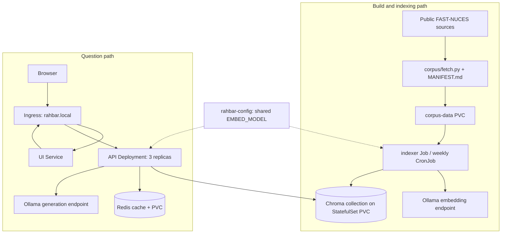

# RAHBAR architecture notes

RAHBAR has two independent execution paths. The indexing path is an on-demand batch workload; the query path is an always-on service.

## Why Chroma is a StatefulSet

Chroma is a single logical database instance backed by persistent local storage. A StatefulSet gives its pod a stable ordinal identity and provisions a dedicated persistent volume through `volumeClaimTemplates` (`k8s/base/chroma.yaml:58-65`). A Deployment is appropriate for interchangeable stateless API replicas, but a database process whose on-disk collection must survive pod replacement should have stable storage identity. The Service is ClusterIP-only; Chroma is not exposed outside the cluster.

## Network boundaries

The NetworkPolicy starts with default-deny. DNS is allowed for service discovery. Ingress traffic reaches UI and API; UI/API communication is constrained; Chroma accepts traffic from API and indexer only; Redis accepts traffic from API only. The UI cannot directly reach Chroma. See `k8s/base/networkpolicy.yaml` and `docs/evidence/networkpolicy-proof.txt`.

## Embedding compatibility

The API and indexer consume `EMBED_MODEL` from the same ConfigMap. The indexer writes the model name and vector dimension into collection metadata. The API checks the collection metadata during startup and on readiness; a mismatch returns 503 with `failed: embedding-pin`. This prevents querying vectors with a different embedding space.
